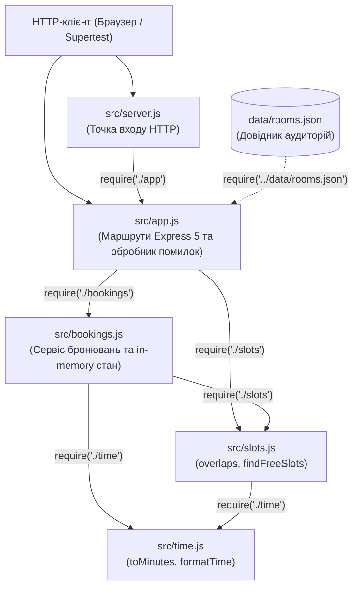

# Архітектурний опис сервісу `room-booking`

Документ описує архітектуру сервісу бронювання аудиторій коледжу на двох рівнях абстракції (контекст системи та модульна будова), а також деталізує обробку ключового сценарію створення бронювання.

---

## 1. Рівень 1 — Контекст системи

Сервіс `room-booking` виконує роль централізованого HTTP API для управління розкладом зайнятості аудиторій навчального закладу.

### Користувачі та зовнішні взаємодії
- **Клієнти API (викладачі, працівники навчальної частини, клієнтський веб-інтерфейс або бот розкладу):**
  - переглядають перелік доступних аудиторій та їхні робочі години (`GET /api/rooms`);
  - перевіряють розклад зайнятості конкретної аудиторії на обрану дату (`GET /api/rooms/:id/bookings`);
  - шукають вільні часові «вікна» потрібної мінімальної тривалості (`GET /api/rooms/:id/free`);
  - реєструють нові бронювання (`POST /api/bookings`) і скасовують наявні (`DELETE /api/bookings/:id`).
- **Джерело даних про аудиторії (`data/rooms.json`):**
  - довідник аудиторій (ідентифікатор `id`, назва `name`, місткість `seats`, час відкриття `opens` та закриття `closes`) завантажується зі статичного JSON-файлу під час ініціалізації `src/app.js`;
  - фабрична функція `createApp(rooms = defaultRooms)` дозволяє передати альтернативний список аудиторій у тестах без зміни файлу на диску.
- **Операційне середовище (Node.js):**
  - конфігурація порту (`PORT`) та максимальної тривалості бронювання (`MAX_BOOKING_HOURS`) зчитується зі змінних середовища `process.env`.

---

## 2. Рівень 2 — Складові частини та залежності модулів

Кодова база в каталозі `src/` поділена на п'ять модулів із чітким односпрямованим графом залежностей (від транспортного рівня HTTP до чистих функцій роботи з часом):

| Модуль | Відповідальність | Внутрішні залежності (`require`) |
| :--- | :--- | :--- |
| `src/server.js` | Точка входу: зчитує `process.env.PORT` (або `3000`) і запускає HTTP-сервер Express | `./app` |
| `src/app.js` | Транспортний рівень HTTP (Express 5): реєструє 5 маршрутів REST API, парсер `express.json()` та централізований обробник помилок | `./bookings`, `./slots`, `../data/rooms.json` |
| `src/bookings.js` | Доменний сервіс та сховище в пам'яті: перевіряє бізнес-правила створення/скасування бронювань і формує помилки `httpError` (400, 404, 409) | `./time`, `./slots` |
| `src/slots.js` | Обчислювальне ядро розкладу: перевірка перетину інтервалів (`overlaps`) та алгоритм пошуку вільних слотів (`findFreeSlots`) | `./time` |
| `src/time.js` | Базові утиліти конвертації часу між форматом `"ГГ:ХХ"` і хвилинами від початку доби (`toMinutes`, `formatTime`) | *немає* |

### Діаграма залежностей модулів (Mermaid Flowchart)

---

## 3. Ключовий сценарій: створення бронювання (`POST /api/bookings`)

Нижче наведено повний шлях проходження запиту `POST /api/bookings` від отримання HTTP-пакета до збереження запису в пам'яті або повернення помилки:

1. **Прийом запиту та десеріалізація (`src/app.js`):**
   - Middleware `express.json()` розбирає тіло HTTP-запиту у JSON-об'єкт `req.body` (`{ roomId, date, from, to, who }`).
   - Обробник маршруту `app.post("/api/bookings", ...)` викликає `service.create(req.body)`.
2. **Перевірка існування аудиторії (`src/bookings.js` -> `findRoom`):**
   - Сервіс шукає аудиторію з `r.id === roomId` у масиві `rooms`.
   - Якщо аудиторію не знайдено — викидається `httpError(404, "Аудиторію не знайдено")`.
3. **Конвертація та валідація формату часу (`src/time.js` -> `toMinutes`):**
   - Межі `from` і `to` переводяться у хвилини від початку доби: `span = { start: toMinutes(from), end: toMinutes(to) }`.
   - Якщо будь-який рядок не відповідає регулярному виразу `/^([01]\d|2[0-3]):([0-5]\d)$/`, викидається `RangeError`.
4. **Перевірка додатної тривалості інтервалу (`src/bookings.js`):**
   - Якщо `span.end <= span.start`, викидається `httpError(400, "Кінець має бути пізніше за початок")`.
5. **Перевірка відповідності робочим годинам аудиторії (`src/bookings.js`):**
   - Межі `span.start` і `span.end` порівнюються з `toMinutes(room.opens)` та `toMinutes(room.closes)`.
   - Якщо інтервал виходить за межі робочого дня аудиторії (`span.start < opens` або `span.end > closes`), викидається `httpError(400, "Аудиторія в цей час зачинена")`.
6. **Перевірка максимальної тривалості (`src/bookings.js`):**
   - Якщо `span.end - span.start > MAX_BOOKING_HOURS * 60` (понад 240 хв за замовчуванням), викидається `httpError(400, "Занадто довге бронювання")`.
7. **Перевірка відсутності перетинів із наявними бронюваннями (`src/bookings.js` -> `src/slots.js`):**
   - Метод `this.list(roomId, date)` відбирає всі існуючі бронювання цієї аудиторії на ту саму дату.
   - Для кожного з них викликається `overlaps(span, { start: toMinutes(b.from), end: toMinutes(b.to) })`.
   - Якщо знайдено конфліктне бронювання `clash`, викидається `httpError(409, "Перетин із бронюванням #...")`.
8. **Збереження та успішна відповідь (`src/bookings.js` -> `src/app.js`):**
   - Формується об'єкт `{ id: nextId++, roomId, date, from, to, who }`, який додається в масив `bookings`.
   - Маршрут Express повертає клієнту статус `201 Created` та створений JSON-об'єкт.
9. **Централізована обробка помилок (`src/app.js`):**
   - Якщо на кроках 2–7 виник виняток, Express 5 автоматично передає його в error-handling middleware `app.use((err, req, res, next) => ...)`, який формує відповідь зі статусом `err.status || 500` та тілом `{ error: err.expose ? err.message : "Внутрішня помилка" }`.

---

## 4. Записи архітектурних рішень (ADR)

Обґрунтування ключових проєктних рішень зафіксовано в каталозі `docs/adr/`:
- [ADR 0001 — Зберігання бронювань у пам'яті процесу](adr/0001-in-memory-booking-storage.md)
- [ADR 0002 — Напіввідкриті інтервали часу для перевірки перетинів і пошуку слотів](adr/0002-half-open-time-intervals.md)
